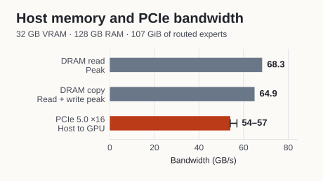
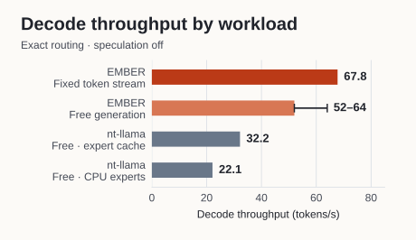
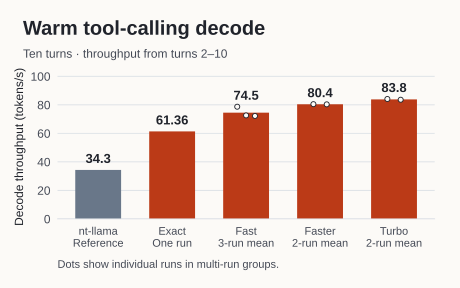
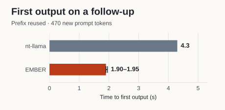

# EMBER Public Technical Report

**English** · [简体中文](PUBLIC-TECH-REPORT.zh-CN.md)

The measurements cover November 21–23, 2026. The workload was DeepSeek-V4.1-Flash-1017 text inference using Unsloth's UD-IQ1_S quantization. The workstation ran Windows 11 (WDDM) with one RTX 5090 (32 GB VRAM), a Ryzen 9 9950X3D, 128 GB of dual-channel DDR5, and an NVMe SSD. [DeepSeek model card](https://huggingface.co/deepseek-ai/DeepSeek-V4.1-Flash-1017) · [Unsloth GGUF](https://huggingface.co/unsloth/DeepSeek-V4.1-Flash-1017-GGUF)

## Hardware constraints

The model's routed expert weights total about 107 GiB, well beyond the memory capacity of one card. Each generated token triggers expert selection at every layer. A major decode cost is processing experts that miss the GPU cache. Host memory bandwidth and PCIe transfer throughput both limit this work. The Engram lookup table is backed by local SSD storage.

Hardware microbenchmarks measured a peak sequential read bandwidth of about 68 GB/s from dual-channel memory and about 54–57 GB/s for transfers from pinned host memory to the GPU over PCIe 5.0 x16. CPU memory accesses and DMA share host bandwidth, so the cost of cache misses depends on their contention.

## Expert placement during decode

| Expert location | How the engine uses it |
| --- | --- |
| GPU memory | The GPU computes experts present in its VRAM cache. |
| System memory, transferred to GPU | Selected misses are transferred on demand over PCIe via DMA, then computed on the GPU. A transferred expert can stay in the cache for reuse. |
| System memory | The CPU reads and computes the remaining misses in place. This saves a PCIe transfer and uses CPU compute and DRAM bandwidth. |

CPU execution and on-demand GPU transfers can overlap with work on cached experts. The expert weights in the measured configuration are resident in system RAM. The SSD serves Engram lookups, and streaming routed expert weights from SSD is a separate development milestone. [Decode trade-offs](WHY-FASTER.md)

## Dynamic KV cache

The KV cache and expert cache share a VRAM budget. Short conversations leave more room for experts. KV capacity grows on demand as the context length increases, reducing the space available for expert reuse. Resetting the context returns that capacity to the expert cache.

The configured limit is 262,144 tokens shared by the prompt, chat template, and generated output. The published retrieval tests reached about 245K prompt tokens. [Long-context measurements](results/long-context.csv)

## Single-user inference

- **Long-prompt prefill.** The batched forward pass processes weights and activations layer by layer. Prefill can borrow GPU expert-cache memory as temporary workspace.
- **Multi-turn prefix reuse.** The engine can append to the live context when it matches the request prefix. If the conversation branches, it can restore a valid checkpoint whose tokens still match and process only the suffix.
- **Speculative decoding.** Exact mode can use DSpark and context suffixes to propose drafts for the target model to verify. The project checks consistency between batched verification and token-by-token decoding.
- **Optional speed modes.** Lite adjusts expert selection. Fast, Faster, and Turbo can also skip some low-weight experts that miss the GPU cache. Prefill keeps exact routing. Each mode has its own performance and quality measurements.

Exact mode preserves the model's routing semantics for the quantized weights and uses F16 KV. CPU and GPU arithmetic paths can affect numerical results, and performance varies with the workload. [Quality evaluation and scope](QUALITY.md)

## Performance results

| Workload | EMBER | Reference result or conditions |
| --- | --- | --- |
| 28-token prompt, followed by about 1.5K decode tokens | Exact, speculation off, fixed token stream. Three-run mean of 67.8 tokens/s | nt-llama, exact, speculation off, free greedy generation. Three-run mean of 32.2 tokens/s |
| 10 turns with tool calls, thinking enabled, sampling | Exact mode ranged from 58 to 64 tokens/s in historical runs. One representative run reached 61.36 tokens/s | nt-llama Exact mode measured 34.34 tokens/s |
| Tool-calling workload in Turbo mode | Two-run mean of 83.8 tokens/s | NLL on general rose by about 2.4% relative to Exact mode |
| Model loaded, 14,392-token prompt | 2,824–3,069 prefill tokens/s | About 20.5 GiB of configured expert cache |
| Prefix reuse with 470 new tokens | 1.90–1.95 s to first output | nt-llama recorded 4.3 s |
| About 128K and 245K prompt tokens, Exact mode with speculation off | 45.7 and 45.4 tokens/s respectively over 400 steady-state decode tokens | Both lengths passed retrieval at all three tested depths |

EMBER's fixed-stream microbenchmark feeds the same token sequence each time. In nt-llama's free greedy generation, the generated text determines which experts are accessed. Sampling and tool turns also affect the agent workload. The standalone scripts can measure custom workloads over HTTP. [Benchmark protocol](BENCHMARK.md) · [Measurement data](results/README.md)

### Decode benchmark

### Tool-calling decode

Exact shows the representative **61.36 tokens/s** run with DSpark and suffix drafting. Fast, Faster, and Turbo show means of their recorded runs. The dots show individual runs for those three modes. [Per-run data](results/agent-hot-runs.csv)

### Follow-up with prefix reuse

## Quality trade-offs by speed mode

| Mode | Recorded speed | NLL on general vs. Exact mode |
| --- | --- | --- |
| Lite | 85.4 tokens/s on average across six short-prompt categories with greedy decoding. Exact mode averaged 71.6 | −0.13%, within the variation observed in those runs |
| Fast | About 74.5 tokens/s in the warm tool-calling benchmark | +0.85% |
| Faster | About 80.4 tokens/s in the warm tool-calling benchmark | +1.3% |
| Turbo | About 83.8 tokens/s in the warm tool-calling benchmark | +2.4% |

These quality differences apply to the tested cases and settings. Short-prompt greedy decoding and warm tool-calling runs use different workloads. The speed-mode figures are historical summaries. [Configurations covered by per-case files](QUALITY.md)

Validation covers this single-GPU Windows setup, one user, and text inference with the specified model. The roughly 245K-token retrieval check covers three synthetic needle positions. Historical runs recorded a crash and a hang during dynamic context use. Subsequent attempts did not reproduce them, and stability may vary by workload.
