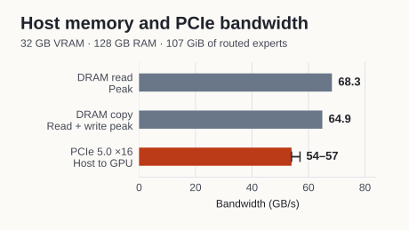
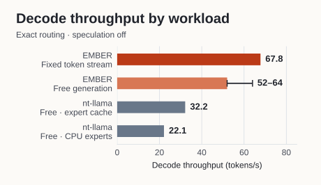
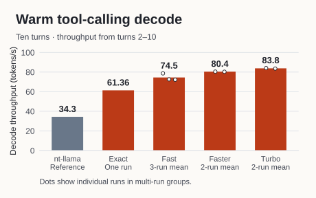
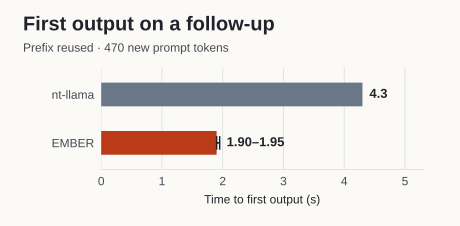

# 火种 EMBER 公开技术报告

[English](PUBLIC-TECH-REPORT.md) · **简体中文**

测量记录覆盖 2026 年 11 月 21–23 日。工作负载为 DeepSeek-V4.1-Flash-1017 文本推理，硬件为单 RTX 5090（32 GB）、Ryzen 9 9950X3D、128 GB 双通道 DDR5 和 NVMe SSD，系统为 Windows 11（WDDM）。模型采用 Unsloth 的 UD-IQ1_S 量化。 [DeepSeek 模型卡](https://huggingface.co/deepseek-ai/DeepSeek-V4.1-Flash-1017) · [Unsloth GGUF](https://huggingface.co/unsloth/DeepSeek-V4.1-Flash-1017-GGUF)

## 资源约束

模型的路由专家权重约 107 GiB，远大于单卡显存。每生成一个 token，路由器为每层选出的专家决定下一步需要读取哪些权重。解码的主要成本之一是处理未命中显存缓存的专家，CPU 内存带宽和 PCIe 搬运能力共同限制这一部分。Engram 查找表由本机 SSD 支撑。

硬件微测显示双通道内存顺序读取峰值约 68 GB/s，锁页源经 PCIe 5.0 x16 向设备传输约 54–57 GB/s。CPU 内存访问和 DMA 会竞争主机带宽，估算未命中成本时需把这种竞争计入。

## 解码时的专家权重放置

| 权重位置 | 执行方式 |
| --- | --- |
| 显存 | GPU 直接计算已在显存缓存中的专家。 |
| 系统内存，搬到 GPU | 部分未命中的专家按需经 PCIe DMA 搬到 GPU 计算。搬入的专家可留在显存中供后续复用。 |
| 系统内存 | 其余未命中的专家由 CPU 直接在内存中读取并计算，省去 PCIe 搬运，同时占用 CPU 算力和内存带宽。 |

CPU 就地计算和按需搬运可与显存命中专家的计算重叠。实测配置的专家权重常驻系统内存，SSD 承载 Engram 查表。路由专家权重的 SSD 流式加载是单独的开发里程碑。 [解码性能取舍](WHY-FASTER.zh-CN.md)

## 动态 KV 缓存

KV 缓存与专家缓存共享显存预算。短对话把更多显存留给专家，上下文变长时 KV 按需扩容，可用于复用专家的空间随之减少。上下文重置后，释放的容量归还给专家缓存。

配置上限为 262,144 token，由提示、模板和生成共同使用。公开检索测试覆盖了约 245K token 的提示。 [长上下文测量](results/long-context.csv)

## 单用户推理路径

- **长提示预填充。** 批量前向按层处理权重和激活，预填充阶段可借用专家缓存的显存作临时工作区。
- **多轮前缀复用。** 当前上下文匹配请求前缀时，可直接追加。对话分叉时，可恢复 token 仍匹配的有效检查点，只处理后续内容。
- **投机解码。** 精确配置可用 DSpark 和上下文后缀提出草稿，由主模型验证。项目对批量验证与逐步解码做一致性检查。
- **可选加速档。** Lite 调整专家选择，Fast、Faster 和 Turbo 还可跳过部分低权重未命中专家。预填充沿用精确路由。加速档的速度和质量需各自记录。

精确档保留模型在所用量化权重下的路由语义，KV 使用 F16。CPU/GPU 算术路径和工作负载可影响数值与速度。具体质量证据及比较范围见 [质量测试](QUALITY.zh-CN.md)。

## 性能结果

| 负载 | 火种 | 参考结果或条件 |
| --- | --- | --- |
| 28 token 提示，解码约 1.5K token | 精确、无投机，固定 token 流三次均值 67.8 token/s | nt-llama 精确、无投机，自由贪心三次均值 32.2 token/s |
| 10 轮工具调用，思考开启、采样 | 精确档历史范围 58–64 token/s，代表测次 61.36 token/s | nt-llama 精确档 34.34 token/s |
| 同类工具调用，Turbo 档 | 两次均值 83.8 token/s | general NLL 相对精确档约 +2.4% |
| 模型已加载，14,392 token 提示 | 2,824–3,069 token/s | 约 20.5 GiB 专家缓存配置 |
| 复用前缀，追加 470 token | 首次输出 1.90–1.95 s | nt-llama 记录值 4.3 s |
| 约 128K / 245K 提示，精确、无投机 | 400 token 稳态解码 45.7 / 45.4 token/s | 两个长度各三个检索深度通过 |

火种的固定 token 微基准使用同一段 token 流，nt-llama 的自由贪心会随输出改变专家访问。工具调用场景同样受采样和工具轮次影响。客户端可用独立脚本评估自选负载，测量协议和证据粒度见 [测试协议](BENCHMARK.zh-CN.md) 和 [结果索引](results/README.zh-CN.md)。

### 解码微基准

### 工具调用解码

精确档标出启用 DSpark 和后缀草稿时的 **61.36 token/s** 代表测次。Fast、Faster、Turbo 标出各自已记录测次的均值，圆点为各次测量。 [逐次测量](results/agent-hot-runs.csv)

### 复用前缀的追问

## 加速档的质量取舍

| 档位 | 速度记录 | general NLL 相对精确档 |
| --- | --- | --- |
| Lite | 六类短提示贪心平均 85.4 token/s，精确档为 71.6 token/s | −0.13%，在该轮实验的波动范围内 |
| Fast | 工具调用热态约 74.5 token/s | +0.85% |
| Faster | 工具调用热态约 80.4 token/s | +1.3% |
| Turbo | 工具调用热态约 83.8 token/s | +2.4% |

质量差异针对测试样例和运行设置。短提示贪心速度与工具调用热态速度采用不同负载。加速档记录为历史汇总，逐样例文件覆盖的配置见 [质量测试](QUALITY.zh-CN.md)。

已验证范围集中在这套 Windows 单卡环境、单用户文本推理和指定模型。约 245K token 的检索验证覆盖少量合成位置。动态上下文历史上记录过未复现的崩溃与卡死，稳定性仍受具体负载影响。
