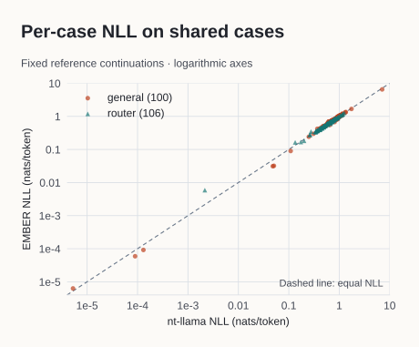
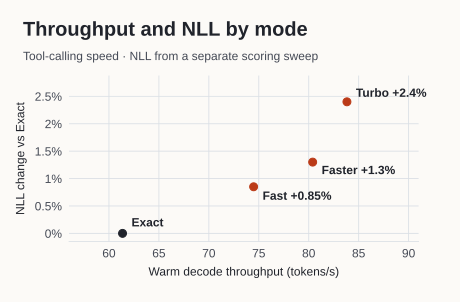

# Quality Evaluation

**English** · [简体中文](QUALITY.zh-CN.md)

## Fixed reference continuations

We render prompts from the public datasets with the DeepSeek chat template and thinking disabled. With teacher forcing, we feed the reference continuation token by token and record the probability assigned to each target token. DwarfStar collected the reference data from the DeepSeek API. Its repository provides the prompts, continuations, manifests, and reference scoring procedure. [DwarfStar evaluation datasets and methodology](https://github.com/antirez/ds4/tree/b3f50180ec2c7324892be1f50bc83555ccb8d5e7/gguf-tools/quality-testing)

- **Mean NLL (nats/token).** Sum the negative log-likelihood across target positions and divide by the total number of target tokens. Lower values indicate more probability assigned to the observed reference tokens.
- **First-token matches.** Count the cases where the first greedy token matches the first reference token.
- **Mean LCP (tokens).** For each case, find the longest common prefix of the greedy output and reference continuation, then average its length across cases.

## Per-case results

| Dataset and configuration | Cases | Target tokens | Mean NLL | First-token matches | Mean LCP |
| --- | ---: | ---: | ---: | ---: | ---: |
| general · nt-llama, fusion on | 100 | 3,388 | 0.792989 | 81/100 | 6.65 |
| general · nt-llama, fusion off | 100 | 3,388 | 0.790577 | 81/100 | 6.61 |
| general · EMBER Exact mode, token-by-token decode | 100 | 3,388 | 0.793400 | 80/100 | 6.72 |
| router · nt-llama, paired subset | 106 | 7,740 | 0.617568 | 73/106 | 3.93 |
| router · EMBER Exact mode, scored after prefill | 106 | 7,740 | 0.618124 | 76/106 | 3.92 |
| router · nt-llama, full rerun | 112 | 8,192 | 0.605113 | 74/112 | 3.78 |

On general, EMBER's NLL is about 0.000411 nats/token (+0.052%) higher than nt-llama with fusion on. Toggling fusion in the reference engine changed its NLL by about 0.002412 nats/token, which illustrates how an implementation setting affects the score. The EMBER router file omits the six longest prompts. The longest prompt in the paired comparison is 7,224 tokens. Task accuracy, free generation, and longer prompts require their own evaluations.

The TSV files retain the scorer's original numeric precision. The summary script verifies case IDs and token counts and reports metrics on shared cases. [Per-case TSV files](results/quality/) · [Commands to recalculate the table](benchmark/README.md)

## Speed and NLL by routing mode

Throughput comes from the 10-turn tool-calling workload. The Exact point uses the representative 61.36 tokens/s run. NLL changes come from a separate sweep on the 100-case general set, against that sweep's own Exact baseline. [Per-run speeds](results/agent-hot-runs.csv) · [NLL by mode](results/routing-quality-summary.csv)

## Long context and decode consistency

- **Synthetic retrieval.** We inserted a marker at approximately 10%, 50%, and 90% of prompts of about 64K, 128K, and 245K tokens. At each length, all three runs returned the marker. [Long-context summary](results/long-context.csv)
- **Numerical regression checks.** The project compares tensors and logits layer by layer with a reference engine. It also checks decode state and greedy output before and after changes intended to preserve the result, and verifies consistency between speculative verification and token-by-token decoding.
- **Speed modes.** NLL changes for Lite, Fast, Faster, and Turbo come from a separate sweep on general. Exact mode scored 0.791885 NLL in that sweep. [Routing quality summary](results/routing-quality-summary.csv)
