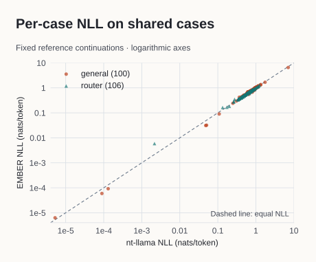
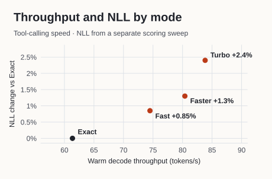

# 质量测试

[English](QUALITY.md) · **简体中文**

## 固定参考续写

测试把公开数据集中的提示经 DeepSeek chat template 渲染，思考关闭，逐位置输入参考续写的 token 并读取该 token 的概率。数据集由 DwarfStar 收集自 DeepSeek API。可获取提示、续写、manifest 和参考评分流程。 [DwarfStar 质量测试与数据集](https://github.com/antirez/ds4/tree/b3f50180ec2c7324892be1f50bc83555ccb8d5e7/gguf-tools/quality-testing)

- **平均 NLL（nat/token）**为全部目标位置负对数似然之和除以目标 token 总数，越低表示对这些参考 token 分配的概率越高。
- **首 token 命中**统计贪心首 token 与参考续写首 token 相同的样例数。
- **平均 LCP**统计贪心输出与参考续写的最长公共前缀，再按样例平均，单位是 token。

## 逐样例结果

| 数据与设置 | 样例 | 目标 token | 平均 NLL | 首 token 命中 | 平均 LCP |
| --- | ---: | ---: | ---: | ---: | ---: |
| general · nt-llama，融合开 | 100 | 3,388 | 0.792989 | 81/100 | 6.65 |
| general · nt-llama，融合关 | 100 | 3,388 | 0.790577 | 81/100 | 6.61 |
| general · 火种精确档，逐 token 解码 | 100 | 3,388 | 0.793400 | 80/100 | 6.72 |
| router · nt-llama，配对的 106 条 | 106 | 7,740 | 0.617568 | 73/106 | 3.93 |
| router · 火种精确档，预填充后评分 | 106 | 7,740 | 0.618124 | 76/106 | 3.92 |
| router · nt-llama，完整重跑 | 112 | 8,192 | 0.605113 | 74/112 | 3.78 |

general 上火种相对融合开启的 nt-llama 增加约 0.000411 nat/token（+0.052%）。相同参考引擎切换融合设置的差值约 0.002412 nat/token，可用于观察实现设置带来的数值变化。router 的火种文件缺少 6 条最长提示，配对结果覆盖的火种提示最多 7,224 token。上述数据支持这两个样例集上的比较，任务正确率、自由生成和更长提示需要相应评测。

每个 TSV 保留评分器的原始数值精度。汇总脚本验证用例 ID 和 token 计数，按共同用例输出两侧指标。发布的表格可直接从 [逐样例 TSV](results/quality/) 重算，命令见 [脚本说明](benchmark/README.zh-CN.md)。

## 加速档的速度与 NLL

速度来自 10 轮工具调用测试。精确档使用 **61.36 token/s** 的代表测次。NLL 变化来自独立的 general 100 样例扫描，以该轮扫描的精确档为基线。 [逐次测速](results/agent-hot-runs.csv) · [档位 NLL](results/routing-quality-summary.csv)

## 长上下文与解码一致性

- **合成检索。** 约 64K、128K、245K token 的长提示，各在约 10%、50%、90% 位置植入标记，检查回复是否召回标记。历史记录各组 3/3 通过，证据层级见 [长上下文汇总](results/long-context.csv)。
- **数值回归。** 项目以参考引擎逐层对照张量和 logits，同时检查可无损改动前后的解码状态、贪心输出，以及投机验证与逐步解码的一致性。
- **加速档。** Lite、Fast、Faster、Turbo 的 NLL 变化来自单独的 general 扫描，该组精确档 NLL 为 0.791885。 [档位质量汇总](results/routing-quality-summary.csv)
