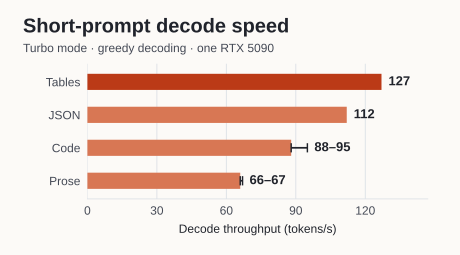
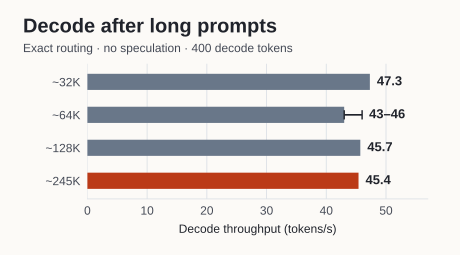

# 火种 EMBER

[English](README.md) · **简体中文**

> 断网断电，火种不灭。
>
> *When the grid goes dark, the ember still thinks.*

火种是面向单用户的离线推理引擎。它以一台 Windows 11 工作站为目标，在单张 RTX 5090（32 GB 显存）和 128 GB 系统内存上运行 DeepSeek-V4.1-Flash-1017 的 UD-IQ1_S 量化版。模型和运行依赖准备齐全后，推理可在本机离线完成。

这个仓库发布技术报告、测试方法、独立基准工具与测量记录。我们计划在完善 SSD 流式加载并完成 1M token 全长上下文的端到端测试后，开源火种推理引擎。 [开源计划与兼容性](FAQ.zh-CN.md)

**技术交流与合作** · [ntcubic@gmail.com](mailto:ntcubic@gmail.com)

## 核心技术

- **CPU 与 GPU 协同解码。** GPU 计算显存命中的专家，同时一部分未命中专家由 CPU 在内存中直接计算，另一部分经 PCIe 搬到 GPU 计算。
- **专家按需进入显存。** 实测配置把约 107 GiB 的路由专家权重常驻系统内存，并在显存缓存近期使用的专家。CPU 就地计算可以省一次搬运，搬到 GPU 则可加快计算，并为后续复用留在显存。SSD 专家权重流式加载是单独的里程碑。
- **KV 和专家权重共享显存预算。** 短对话把更多显存留给专家。对话变长时 KV 缓存按需扩容，上下文重置后容量归还给专家缓存。 [动态 KV 缓存](PUBLIC-TECH-REPORT.zh-CN.md#动态-kv-缓存)
- **预填充重叠搬运与 GPU 计算。** 多轮追问可以复用匹配的前缀，只处理剩余 token。
- **投机解码和路由优化分别控制质量。** 精确档可以用主模型验证 DSpark 或上下文后缀提出的草稿。可选加速档在解码时调整专家选择，部分档位还会跳过低权重专家。 [质量测试](QUALITY.zh-CN.md)

CPU 就地计算、专家复用和长上下文的性能取舍见 [火种为什么快](WHY-FASTER.zh-CN.md)。

## 单机实测

### 短提示生成速度

单张 RTX 5090，Turbo 档、贪心解码，表格生成达到 **127 token/s**。

### 长上下文解码

同一台 Windows 11 工作站，单张 RTX 5090 和 128 GB 内存。输入约 245K token 后，火种在精确路由、关闭投机解码的条件下，400 个稳态解码 token 实测 **45.4 token/s**。同长度的合成检索在三个测试深度均通过。 [长上下文测量汇总](results/long-context.csv)

### Agent 与预填充

| 场景 | 火种结果 |
| --- | --- |
| 10 轮工具调用与采样，取第 2–10 轮热态解码 | 精确档 58–64 token/s，Turbo 档两次均值 83.8 token/s |
| 14,392 token 提示，模型已加载 | 预填充 2,824–3,069 token/s |
| 复用上下文后追加 470 token | 首次输出 1.90–1.95 s |

这些数字来自项目内部实测。各场景的设置、数据粒度与复测条件见 [测试协议](BENCHMARK.zh-CN.md) 和 [结果索引](results/README.zh-CN.md)。

## 材料

- [公开技术报告](PUBLIC-TECH-REPORT.zh-CN.md) — 资源约束、CPU/GPU 分工、长上下文和速度取舍。
- [测试协议](BENCHMARK.zh-CN.md) — 性能指标、负载定义与对照方法。
- [质量测试](QUALITY.zh-CN.md) — 逐样例 NLL、长上下文检索与可核算范围。
- [独立测速脚本](benchmark/README.zh-CN.md) — 使用 Python 标准库测试本地 Chat Completions 服务。
- [测试数据](results/README.zh-CN.md) — 原始逐样例分数、逐次速度摘录和历史汇总。
- [FAQ](FAQ.zh-CN.md) · [技术交流与合作](CONTACT.zh-CN.md)
